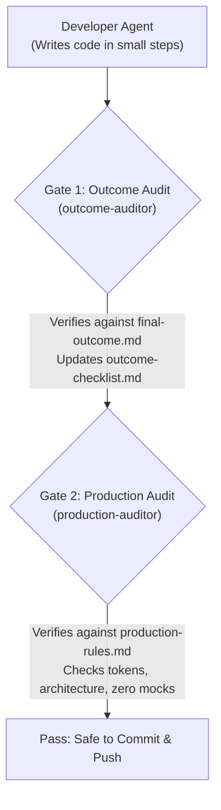

# Lahm Platform — Agent Workflow & Governance Guide

> **Target Audience:** Antigravity Agents (both Remote Codespace Agent and Local Machine Agent)  
> **Status:** Active & Mandatory  
> **Last Updated:** October 2026  

---

## 1. Purpose of This Document

This guide is the **primary operational handbook** for any AI agent working on the Lahm repository. Because development alternates between a **Remote Agent** (in GitHub Codespaces) and a **Local Agent** (on the local workstation), this document ensures that:

1. Both agents share the exact same mental model of the project's current state and development philosophy.
2. No agent suffers from context drift, hallucinated requirements, or forgotten constraints.
3. Every step directly advances the platform toward the end-to-end outcome defined in [`context/final-outcome.md`](./final-outcome.md).

---

## 2. Core Development Methodology

We develop using two complementary engineering frameworks:

### A. Specification-Driven Development (SDD)
Before writing code for any feature, the agent and developer discuss and agree upon the production-grade approach:
- **No rushed assumptions:** Agree on entity structures, database relationships, error cases, and API contracts upfront.
- **Production-grade first:** Never implement quick "prototypes" or temporary hacks. Write code intended for production from day one.
- **Step-by-step execution:** Break features down into small, verifiable slices (1–2 files per turn).

### B. Context-Driven AI Development
- **Source of Truth:** [`context/final-outcome.md`](./final-outcome.md) describes the immutable product reality across all three mobile applications (**Customer**, **Merchant**, **Delivery Partner**).
- **Outcome Grounding:** Before implementing a step, the agent must check which specific user flow from `final-outcome.md` is being built.
- **Traceability:** Completed features are tracked in [`context/outcome-checklist.md`](./outcome-checklist.md), connecting requirements directly to real code files.

---

## 3. The Dual-Auditor Governance Architecture

To maintain uncompromising standards, two dedicated read-only auditor subagents review the work:



| Auditor | Role & Question Answered | Source of Truth | Key Responsibilities |
|---|---|---|---|
| **`outcome-auditor`** | **Product & Scope Guardian**<br>*"Are we building the right things to achieve the final outcome?"* | [`context/final-outcome.md`](./final-outcome.md)<br>[`context/outcome-checklist.md`](./outcome-checklist.md) | • Verifies feature completeness against the 3-app user stories.<br>• Identifies missing gaps across apps (e.g. order placed vs merchant queue).<br>• Updates the Traceability Scoreboard (`outcome-checklist.md`). |
| **`production-auditor`** | **Engineering & Code Quality Guardian**<br>*"Are we building it cleanly, correctly, and to production standards?"* | [`.agents/rules/production-rules.md`](../.agents/rules/production-rules.md)<br>Framework best practices | • Enforces strictly ZERO mock/sandbox code.<br>• Enforces 100% design token usage (`@lahm/tokens`, unitless dp/points).<br>• Enforces component lengths under ~200 lines.<br>• Checks DTO validation, transaction boundaries, and native mobile UX. |

---

## 4. Cross-Agent Communication Protocol (Remote ↔ Local)

The synchronized bridge between the **Remote Agent** (Codespaces) and the **Local Agent** is [`context/communication.md`](./communication.md).

### The Golden Handoff Rules:
1. **Always Check `communication.md` First:** Before doing any work, read the latest entry at the bottom of [`context/communication.md`](./communication.md) to understand the exact state left by the previous agent.
2. **Commit and Push Frequently:** Because the Remote Agent runs in Codespaces, all verified changes must be committed and pushed to GitHub so the Local Agent can pull cleanly without merge conflicts.
3. **Log Every Milestone:** When concluding a turn or feature, append an entry to [`context/communication.md`](./communication.md) following this template:

```markdown
### [YYYY-MM-DD HH:MM] — [Remote / Local] Agent Turn Update
- **Phase & Step:** e.g. Phase 6.1 (Step 2 Completed)
- **Files Touched / Created:**
  - `path/to/file1.ts`
- **Important Points for Other Agent:** Brief explanation of key decisions.
- **Verification:** Result of `npx tsc --noEmit` or tests.
- **Next Required Step:** Explicit instruction on what the next agent must do.
```

---

## 5. Strict Execution Constraints (Non-Negotiable)

Every agent must follow these turn-by-turn development constraints:

1. **Strictly 1–2 Files Per Turn:** Never touch or create 3 or more files in a single step. Keep changes small and isolated.
2. **~100 Lines Per Change:** Avoid large code dumps. Focus on high-quality, readable, reviewable code.
3. **Pre-Step & Post-Step Communication:**
   - **Pre-Step:** Explain what files will be created/modified and the architectural reasoning *before* calling write tools.
   - **Post-Step:** Explain what was changed, show compiler verification, and declare the next step *after* writing.
4. **Strictly Zero Mock or Sandbox Code:**
   - No mock notices, no testing banners (e.g. `otpNotice`), no dummy fallback arrays.
   - All code connects to real NestJS REST endpoints backed by PostgreSQL.
5. **100% Design Tokens Usage:**
   - Use tokens from `@lahm/tokens`. No raw hex codes (`#E77A62`) or arbitrary pixel values (`h-[52px]`).
   - Use unitless points/dp (React Native standard).
   - Use `text-screenTitle font-extrabold font-serif` for primary screen headers.
6. **Component Length Limit:** React Native UI components must remain under or around ~200 lines through clean modular decomposition.
7. **Always Verify Compilation:** Run `npx tsc --noEmit` in the modified workspace (`backend/` or `frontend/apps/<app>`) before declaring a step complete.

---

## 6. Mandatory Order of Reading & Writing Files

Follow this exact sequence to ensure flawless execution without token waste or disorientation:

### 📖 Reading Order (When Starting a Turn / Session)
```
1. context/agent-workflow-guide.md  ──> Read this guide to align on protocol.
2. context/communication.md         ──> Read the latest timestamp entry at the bottom.
3. context/plan.md                  ──> Read the active phase & step specification.
4. context/final-outcome.md         ──> Verify the product requirement & cross-app journey.
5. .agents/rules/production-rules.md──> Check engineering constraints before coding.
```

### ✍️ Writing Order (During Feature Execution)
```
1. Target Source Code Files         ──> Implement 1–2 files (<100 lines) with pre-step explanation.
2. Compiler Verification            ──> Run `npx tsc --noEmit` to ensure 0 errors.
3. Gate 1 (Outcome Audit)           ──> Review alignment with final-outcome.md; update outcome-checklist.md.
4. Gate 2 (Production Audit)        ──> Audit against production-rules.md (tokens, zero mocks, architecture).
5. context/communication.md         ──> Append the timestamped turn log entry.
6. Git Commit & Push                ──> Commit with a descriptive message and push to origin/main.
```

---

## 7. Current Project Status & Active Step

* **Phase 0 (Foundation & Tokenization):** 100% Completed.
  - Customer Auth modularized into 5 sub-views under 120 lines each.
  - Tokens converted to unitless points/dp; `screenTitle: 28` standardized.
* **Phase 1 (Design System Primitives):** Deferred to the end of Phase 6.
* **Phase 6.1 (Backend Orders Module):** **ACTIVE**.
  - [x] **Step 1:** `order-status.enum.ts` & `order-item.entity.ts` created and verified.
  - [ ] **Step 2 (NEXT):** Create `backend/src/orders/entities/order.entity.ts`.
  - [ ] **Step 3:** Create DTOs (`create-order.dto.ts`, `update-order-status.dto.ts`, `verify-delivery-otp.dto.ts`).
  - [ ] **Step 4:** Implement `orders.service.ts` Part 1 (Creation, atomic transaction, dynamic pricing).
  - [ ] **Step 5:** Implement `orders.service.ts` Part 2 (Queries & state machine transitions).
  - [ ] **Step 6:** Implement `orders.controller.ts` with guards and role decorators.
  - [ ] **Step 7:** Register in `orders.module.ts` & `app.module.ts`.
