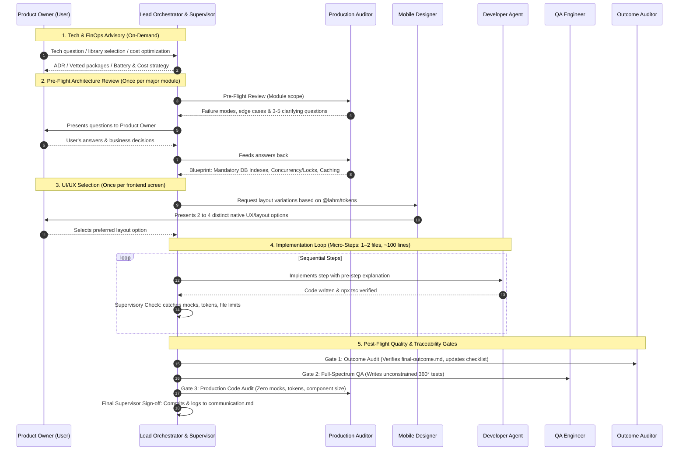

# Lahm Platform — Agent Workflow & Governance Guide

> **Target Audience:** Antigravity Agents (both Remote Codespace Agent and Local Machine Agent)  
> **Status:** Active & Mandatory  
> **Last Updated:** October 2026  

---

## 1. Purpose of This Document

This guide is the **primary operational handbook** for any AI agent working on the Lahm repository. Because development alternates between a **Remote Agent** (in GitHub Codespaces) and a **Local Agent** (on the local workstation), this document ensures that:

1. Both agents share the exact same mental model of the project's current state and development philosophy.
2. No agent suffers from context drift, hallucinated requirements, or forgotten constraints.
3. Every step directly advances the platform toward the end-to-end outcome defined in [`context/final-outcome.md`](./final-outcome.md).

---

## 2. Core Development Methodology

We develop using two complementary engineering frameworks:

### A. Specification-Driven Development (SDD)
Before writing code for any feature, the agent and developer discuss and agree upon the production-grade approach:
- **No rushed assumptions:** Agree on entity structures, database relationships, error cases, and API contracts upfront.
- **Production-grade first:** Never implement quick "prototypes" or temporary hacks. Write code intended for production from day one.
- **Step-by-step execution:** Break features down into small, verifiable slices (1–2 files per turn).

### B. Context-Driven AI Development
- **Source of Truth:** [`context/final-outcome.md`](./final-outcome.md) describes the immutable product reality across all three mobile applications (**Customer**, **Merchant**, **Delivery Partner**).
- **Outcome Grounding:** Before implementing a step, the agent must check which specific user flow from `final-outcome.md` is being built.
- **Traceability:** Completed features are tracked in [`context/outcome-checklist.md`](./outcome-checklist.md), connecting requirements directly to real code files.

### C. The 2-Step Frontend UI/UX Design Protocol
To achieve modern, beautiful, and consistent native mobile screens across all 3 applications:
1. **Step 1 (Global Brand Identity & Tokens — Done Once Upfront):**
   - The brand DNA is locked once in [`@lahm/tokens`](../frontend/packages/tokens/src/tokens.json) and shared base primitives in [`@lahm/ui`](../frontend/packages/ui/).
   - Establishes colors (terracotta, warm sand), typography scales (`screenTitle`), border radiuses, and elevation rules.
2. **Step 2 (Per-Screen Layout Variations & User Selection):**
   - Before writing code for *any* frontend screen, the agent MUST NOT jump straight into coding.
   - The `mobile-designer` agent generates and presents **the best distinct layout & UX options (typically 2 to 4 compelling variations)** to the Product Owner in chat.
   - **Do NOT artificially restrict options to only two:** If there are 3 or 4 strong, distinct UX patterns (e.g. accordion vs. bottom-sheet drawer vs. sticky-footer card), present them clearly.
   - The variations use the *same brand tokens* but explore different **interaction models and layout structures**.
   - The Product Owner chooses their favorite option, and only then does the Developer Agent implement that chosen design.
3. **Native Antigravity Generation (No External Web Translators):**
   - All layouts, mockups, and code are produced natively within Antigravity directly in React Native (Tailwind / NativeWind) to avoid clunky web-to-mobile translation issues.

---


## 3. The Multi-Agent Governance Architecture

### A. The Primary Agent's Triple Mandate (Lead Orchestrator, Supervisor & Tech Advisor)
Whether running as the **Remote Agent** (in Codespaces) or the **Local Agent** (on the workstation), the primary agent you converse with operates under three simultaneous responsibilities:

1. **Chief Orchestrator:**
   - Owns the roadmap in [`context/plan.md`](./plan.md).
   - Sequences steps, dispatches specialized subagents, and facilitates design choices with the Product Owner.
2. **Governance Supervisor (Rule & Mistake Watcher):**
   - Strictly enforces the non-negotiable constraints (Section 5) on every turn.
   - Audits subagent outputs for rule violations:
     - Rejects any mock/dummy arrays, placeholder TODOs, or hardcoded hex colors.
     - Enforces the 1–2 files / ~100 lines limit per turn.
     - Ensures the Mobile Designer presents 2–4 layout options before writing any screen code.
     - Ensures the QA Engineer performs unconstrained 360° testing without artificial test limits.
   - Issues immediate `[SUPERVISOR ALERT]` notices and halts execution if any rule is breached.
3. **Technology Radar & FinOps Advisor:**
   - **Dependency Vetting:** Evaluates candidate npm packages for Expo New Architecture support, bundle size, active GitHub maintenance, and permissive licensing (MIT/Apache 2.0).
   - **Cost & FinOps Optimization:** Prevents Maps API bill shock (mandates Haversine pre-filtering, bounding-box autocompletes) and optimizes SMS/OTP authentication costs.
   - **Mobile Battery & Platform Compliance:** Enforces adaptive GPS polling for delivery drivers, Apple 30% IAP exemption for physical goods (Stripe), and app privacy manifests.
   - **Architecture Decision Records (ADRs):** Produces concise trade-off matrices when evaluating technical forks.

---

### B. The Specialized Subagent Squad

| Role / Agent | Mode | Focus & Key Responsibilities |
|---|---|---|
| **`production-auditor`** | **Mode 1: Pre-Flight** | **Architectural Advisor & Optimizer** (Runs ONCE per module)<br>• Threat models failure modes and generates 3–5 clarifying questions for the user.<br>• Mandates **Database Indexes** (composite & foreign key).<br>• Mandates **Concurrency & Locking** (atomic SQL / pessimistic locks).<br>• Mandates **Caching & Hot Paths** (Redis / TTL caching). |
| **`mobile-designer`** | **Mode 1: Pre-Flight<br>Mode 2: Visual Audit** | **Mobile UI/UX Architect & Visual Inspector**<br>• Mode 1: Presents **2 to 4 distinct layout options** using `@lahm/tokens` before coding.<br>• Mode 2: Inspects live rendered screenshots via `capture-screen.js` to catch visual defects. |
| **`qa-engineer`** | **Post-Flight** | **Adversarial QA & Test Architect**<br>• Unconstrained 360-degree test engineering (`*.spec.ts`).<br>• Exhaustively tests boundary values, DTO fuzzing, RBAC, state transitions, race conditions, and error resilience. |
| **`outcome-auditor`** | **Post-Flight** | **Product & Scope Guardian**<br>• Verifies feature completeness against [`context/final-outcome.md`](./final-outcome.md).<br>• Maintains the Traceability Scoreboard in [`context/outcome-checklist.md`](./outcome-checklist.md). |
| **`production-auditor`** | **Mode 2: Post-Flight** | **Code Quality Guardian**<br>• Enforces strictly ZERO mock code.<br>• Enforces 100% design token usage (`@lahm/tokens`, unitless dp/points).<br>• Enforces component lengths under ~200 lines. |

---

### C. The End-to-End Governance Sequence




---

## 4. Cross-Agent Communication Protocol (Remote ↔ Local)

The synchronized bridge between the **Remote Agent** (Codespaces) and the **Local Agent** is [`context/communication.md`](./communication.md).

### The Golden Handoff Rules:
1. **Always Check `communication.md` First:** Before doing any work, read the latest entry at the bottom of [`context/communication.md`](./communication.md) to understand the exact state left by the previous agent.
2. **Commit and Push Frequently:** Because the Remote Agent runs in Codespaces, all verified changes must be committed and pushed to GitHub so the Local Agent can pull cleanly without merge conflicts.
3. **Log Every Milestone:** When concluding a turn or feature, append an entry to [`context/communication.md`](./communication.md) following this template:

```markdown
### [YYYY-MM-DD HH:MM] — [Remote / Local] Agent Turn Update
- **Phase & Step:** e.g. Phase 6.1 (Step 2 Completed)
- **Files Touched / Created:**
  - `path/to/file1.ts`
- **Important Points for Other Agent:** Brief explanation of key decisions.
- **Verification:** Result of `npx tsc --noEmit` or tests.
- **Next Required Step:** Explicit instruction on what the next agent must do.
```

### How the Local Workstation Operates as Lead Orchestrator & Supervisor:
1. **Pull the Repository:** Run `git pull origin main` on the local machine.
2. **Automatic Context Activation:** Antigravity on the local machine automatically reads `context/agent-workflow-guide.md`, `context/communication.md`, and `.agents/rules/production-rules.md`. The Local Agent instantly inherits the identical **Lead Orchestrator, Supervisor & Tech Advisor** mandate.
3. **Local Device Screen Inspection:**
   - The local workstation has physical USB/Wi-Fi access to Android phones and local emulators via ADB.
   - Running `node scripts/capture-screen.js --app <customer|merchant|delivery>` captures live device screens to `reports/latest-screen.png`.
   - The Local Agent then visually inspects the UI for visual defects and self-corrects code before git commit.
4. **Handoff Back to Codespaces:**
   - Conclude each local session with a descriptive git commit and `git push origin main`.
   - Update [`context/communication.md`](./communication.md) so the Remote Agent picks up smoothly without missing a beat.

---

## 5. Strict Execution Constraints (Non-Negotiable)

Every agent must follow these turn-by-turn development constraints:

1. **Strictly 1–2 Files Per Turn:** Never touch or create 3 or more files in a single step. Keep changes small and isolated.
2. **~100 Lines Per Change:** Avoid large code dumps. Focus on high-quality, readable, reviewable code.
3. **Pre-Step & Post-Step Communication:**
   - **Pre-Step:** Explain what files will be created/modified and the architectural reasoning *before* calling write tools.
   - **Post-Step:** Explain what was changed, show compiler verification, and declare the next step *after* writing.
4. **Strictly Zero Mock or Sandbox Code:**
   - No mock notices, no testing banners (e.g. `otpNotice`), no dummy fallback arrays.
   - All code connects to real NestJS REST endpoints backed by PostgreSQL.
5. **100% Design Tokens Usage:**
   - Use tokens from `@lahm/tokens`. No raw hex codes (`#E77A62`) or arbitrary pixel values (`h-[52px]`).
   - Use unitless points/dp (React Native standard).
   - Use `text-screenTitle font-extrabold font-serif` for primary screen headers.
6. **Component Length Limit:** React Native UI components must remain under or around ~200 lines through clean modular decomposition.
7. **Always Verify Compilation:** Run `npx tsc --noEmit` in the modified workspace (`backend/` or `frontend/apps/<app>`) before declaring a step complete.

---

## 6. Mandatory Order of Reading & Writing Files

Follow this exact sequence to ensure flawless execution without token waste or disorientation:

### 📖 Reading Order (When Starting a Turn / Session)
```
1. context/agent-workflow-guide.md  ──> Read this guide to align on protocol.
2. context/communication.md         ──> Read the latest timestamp entry at the bottom.
3. context/plan.md                  ──> Read the active phase & step specification.
4. context/final-outcome.md         ──> Verify the product requirement & cross-app journey.
5. .agents/rules/production-rules.md──> Check engineering constraints before coding.
```

### ✍️ Execution Order (During Feature Execution)
```
1a. (Backend Module Boundary): Pre-Flight ──> Invoke production-auditor (Mode 1) for failure modes & questions.
                                          ──> Present questions to User; feed answers back.
                                          ──> Receive final blueprint with DB Indexes, Concurrency & Caching.
1b. (Frontend Screen Boundary): Design     ──> Invoke mobile-designer (Mode 1) for layout tree & token blueprint.
2. Target Source Code Files               ──> Implement 1–2 files (<100 lines) with pre-step explanation.
3a. Compiler Verification                  ──> Run `npx tsc --noEmit` to ensure 0 errors.
3b. (Frontend Screen Verification): Visual ──> Run `node scripts/capture-screen.js --app <name>`
                                          ──> Invoke mobile-designer (Mode 2) on reports/latest-screen.png for visual fixes.
4. Gate 1 (Outcome Audit)                 ──> Invoke outcome-auditor; verify final-outcome.md & update checklist.
5. Gate 2 (Adversarial QA Testing)        ──> Invoke qa-engineer; writes edge-case & regression test suite (*.spec.ts).
6. Gate 3 (Production Standards Audit)    ──> Invoke production-auditor (Mode 2); check tokens, zero mocks, code rules.
7. context/communication.md               ──> Append the timestamped turn log entry.
8. Git Commit & Push                      ──> Commit with a descriptive message and push to origin/main.
```

---

## 7. Current Project Status & Active Step

* **Phase 0 (Foundation & Tokenization):** 100% Completed.
  - Customer Auth modularized into 5 sub-views under 120 lines each.
  - Tokens converted to unitless points/dp; `screenTitle: 28` standardized.
* **Phase 1 (Design System Primitives):** Deferred to the end of Phase 6.
* **Phase 6.1 (Backend Orders Module):** **ACTIVE**.
  - [x] **Step 1:** `order-status.enum.ts` & `order-item.entity.ts` created and verified.
  - [ ] **Step 2 (NEXT):** Create `backend/src/orders/entities/order.entity.ts`.
  - [ ] **Step 3:** Create DTOs (`create-order.dto.ts`, `update-order-status.dto.ts`, `verify-delivery-otp.dto.ts`).
  - [ ] **Step 4:** Implement `orders.service.ts` Part 1 (Creation, atomic transaction, dynamic pricing).
  - [ ] **Step 5:** Implement `orders.service.ts` Part 2 (Queries & state machine transitions).
  - [ ] **Step 6:** Implement `orders.controller.ts` with guards and role decorators.
  - [ ] **Step 7:** Register in `orders.module.ts` & `app.module.ts`.
