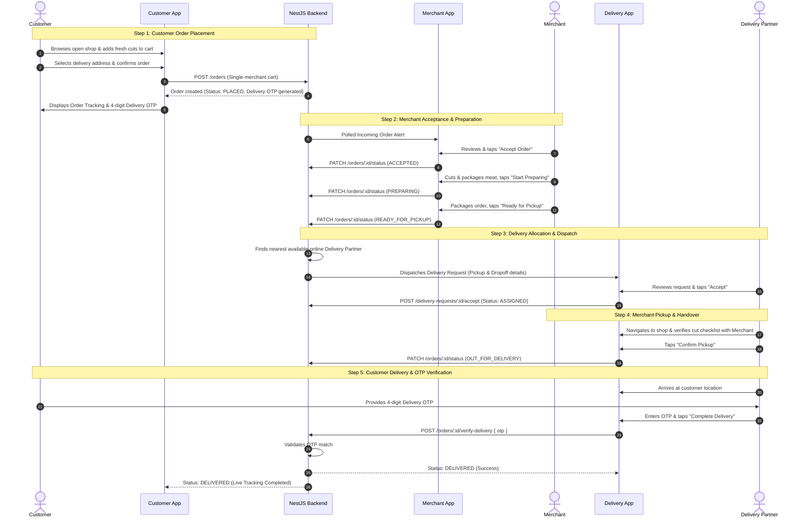

# Lahm Platform — Final Outcome Specification

---

## 1. Vision, Target Schedule & Architecture

The final outcome of Project Lahm is a **complete, production-grade On-Demand Halal Super-App (Meats, Restaurants & Groceries)** powered by a unified backend and 3 native mobile applications.

> [!IMPORTANT]
> **Project Target Completion Date:** **October 27, 2026 IST**  
> All feature development, UI redesign, and quality audits across the 3 applications and backend must be 100% complete, verified, and production-ready by this date.

```
┌─────────────────────────────────────────────────────────────────────────┐
│                           NestJS Backend API                            │
│  (TypeORM + PostgreSQL + Role Authorization + State Machine Engine)     │
└───────────────▲─────────────────────────▲─────────────────────────▲─────┘
                │                         │                         │
     REST / JSON Polling       REST / JSON Polling       REST / JSON Polling
                │                         │                         │
┌───────────────▼────────┐  ┌─────────────▼────────┐  ┌─────────────▼────────┐
│     Customer App       │  │     Merchant App     │  │  Delivery Partner    │
│  (3 Verticals, Cart,   │  │  (Butchers, Dining,  │  │  (Duty, Dispatch,    │
│   Checkout, Tracking)  │  │   Grocers, Orders)   │  │   Pickup, Delivery)  │
└────────────────────────┘  └──────────────────────┘  └──────────────────────┘
```

---

## 2. The 3 Mobile Roles & Responsibilities

### A. Customer App
The customer app is structured around a **5-Tab Department Navigation** with a floating persistent Cart:
1. **🥩 Meats Department:** Location-aware fresh halal meat butchers, meat cuts (beef, mutton, chicken), cut weight selections, and butcher profiles.
2. **🍽️ Restaurants Department:** Halal restaurants and dining hotels, cuisine categories, menus, prepared dish customization, and prep times.
3. **🛒 Groceries Department:** Supermarkets and grocery merchants, daily essentials, pantry staples, and halal FMCG products.
4. **📦 Orders:** Live order tracking timeline (`PLACED` → `DELIVERED`), 4-digit Delivery OTP, and itemized receipts.
5. **👤 Account:** Address book management, notification settings, and profile details.
- **Cart:** Single-merchant cart enforcing quantity steppers, item totals, and dynamic delivery fee calculation, accessible via a floating bottom pill.
- **Address Management:** Select or add delivery addresses (street address, landmark, coordinates, default designation).
- **Checkout & Order Placement:** Review order summary, place order (`POST /orders`).
- **Live Order Tracking:** Real-time visual timeline showing status transitions:
  `PLACED` → `ACCEPTED` → `PREPARING` → `READY_FOR_PICKUP` → `OUT_FOR_DELIVERY` → `DELIVERED`.
- **Delivery OTP:** Displays a secure 4-digit OTP to provide to the delivery partner upon arrival.

### B. Merchant App
- **Authentication:** Merchant account login with persistent credentials and business type (`MEAT_SHOP`, `RESTAURANT`, `GROCERY`).
- **Store Availability Toggle:** One-tap online/offline toggle persisting to the backend (`PATCH /merchants/status`), controlling whether the shop accepts orders.
- **Catalog Management:** Create, edit, and toggle in-stock/out-of-stock items tailored by merchant category: meat cuts (`MEAT_SHOP`), restaurant dishes with prep times (`RESTAURANT`), or supermarket grocery SKUs (`GROCERY`).
- **Real-Time Order Queue:** Polled incoming order queue (`GET /orders/merchant/:id`) with audible/tactile alerts.
- **Order Processing Workflow:**
  - Review incoming order specifications.
  - Accept (`ACCEPTED`) or Decline order.
  - Start Preparation (`PREPARING`).
  - Mark Ready for Pickup (`READY_FOR_PICKUP`).
- **Handover Confirmation:** Verify order ID with the delivery partner upon pickup.

### C. Delivery Partner App
- **Authentication:** Delivery partner login and vehicle profile.
- **Duty Toggle:** One-tap Online/Offline duty toggle (`PATCH /delivery-partners/duty`), registering active availability in the allocation engine.
- **Allocation & Request Screen:** Incoming dispatch request card showing pickup merchant, customer dropoff location, distance, and delivery payout.
- **Pickup Workflow:**
  - Route navigation to merchant shop.
  - Arrive at merchant, verify itemized cut checklist.
  - Tap "Confirm Pickup" (`PATCH /orders/:id/status` → `OUT_FOR_DELIVERY`).
- **Delivery Workflow:**
  - Route navigation to customer address.
  - Call customer CTA.
  - Prompt customer for 4-digit Delivery OTP.
  - Enter OTP & verify (`POST /orders/:id/verify-delivery`).
  - On valid OTP, order transitions to `DELIVERED` and partner returns to available pool.

---

## 3. End-to-End Core Ordering Flow (Lifecycle Sequence)



---

## 4. Professional Native Mobile Standards

To ensure each of the 3 mobile apps feels polished, fluid, and production-grade:
- **No Mock or Seed Data:** All screens connect to real NestJS REST endpoints backed by PostgreSQL.
- **Zero Raw Emojis as Icons:** Strict use of vector stroke icons (`@expo/vector-icons` / Lucide icons).
- **Tactile Haptic Feedback:** `expo-haptics` triggers on button presses, steppers, and order status transitions.
- **Content-Shaped Shimmer Skeletons:** Feed screens render smooth animated shimmer skeletons instead of blank screens with lone spinners.
- **Native Bottom Sheets:** Complex options (address picker, cut weight selection) use gesture-driven bottom sheets with drag handles.
- **Thumb-Zone Layout:** Primary CTAs are fixed at the bottom with safe area insets (`paddingBottom: insets.bottom + 16`).
- **Resilient Polling Synchronization:** Active screens use TanStack Query polling (`refetchInterval: 5000`) for seamless, zero-lag cross-device sync without requiring external third-party infrastructure.

---

## 5. Internationalization & Multi-Country Architecture (India, Japan, China)

To ensure smooth operation across India, Japan, and China without requiring future architectural rewrites:
1. **Multi-Currency & Zero Hardcoded Symbols:**
   - **Zero Hardcoded Currency Signs:** Strictly no hardcoded `₹`, `¥`, or `$` in UI JSX or database strings.
   - **Formatting Utility:** All monetary amounts formatted via `Intl.NumberFormat(locale, { style: 'currency', currency })`.
   - **Zero-Decimal JPY Support:** Financial calculations and displays must handle non-fractional currencies (`JPY` has 0 decimal sub-units, while `INR` and `CNY` have 2 decimal places).
   - **Merchant-Scoped Currency:** Each merchant defines their currency (`'INR' | 'JPY' | 'CNY'`), inherited by order snapshots.
2. **Global E.164 Phone Authentication:**
   - Phone input supports country calling code selection (`+91` India, `+81` Japan, `+86` China) and persists phone numbers in standard E.164 format.
3. **Multi-Language (i18n) Foundation:**
   - User-facing UI strings structured via localization dictionaries (`i18next` / `expo-localization`) for English, Japanese (日本語), and Simplified Chinese (简体中文).
4. **Coordinate-Anchored Flexible Addresses:**
   - Addresses use open text fields (`streetAddress`, `landmark`, `city`) anchored by WGS-84 coordinates (`latitude`, `longitude`), accommodating Japanese prefectures/wards and Chinese provinces/districts without rigid regional constraints.
   - Map rendering is abstracted to allow map provider configuration (Google Maps for India/Japan, Amap/Baidu for China).
5. **Timezone & Operational Hours:**
   - Server timestamps stored in UTC (`TIMESTAMPTZ`); merchant opening/closing schedules evaluated against merchant local timezones (`Asia/Kolkata`, `Asia/Tokyo`, `Asia/Shanghai`).

---

## 6. Acceptance Criteria

The final outcome is achieved when all of the following criteria are met:
1. **Customer Order Placed:** A customer on mobile 1 can browse a real merchant, place an order, and receive a tracking screen with a secure 4-digit OTP.
2. **Merchant Order Processed:** A merchant on mobile 2 receives the order in real-time, accepts it, starts preparation, and marks it ready for pickup.
3. **Delivery Partner Assigned:** A delivery partner on mobile 3 (toggled online) receives the dispatch request, accepts it, and confirms pickup from the merchant.
4. **OTP-Verified Delivery:** The delivery partner delivers the meat package to the customer, enters the customer's 4-digit OTP, and the backend verifies the delivery as completed.
5. **Real-Time State Consistency:** All 3 mobile apps reflect the exact current status of the order at every step of the lifecycle without crashes, desyncs, or stale state.
6. **Multi-Country & Multi-Vertical Compliance:** The app operates cleanly across the 3 business verticals and adheres to multi-currency and international phone standards without hardcoded assumptions.

